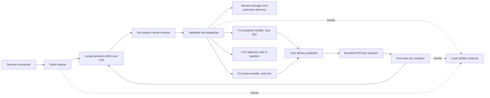

# CSE3461 Unified Chat Platform: Architecture and Interface Baseline

**Execution update, 2026-10-21:** The user subsequently confirmed final coordinator agreement and authorized Native skeleton development. This v0.2 document preserves the original design-stage statements below; current implementation and acceptance status are in [the framework handoff](CSE3461_FRAMEWORK_HANDOFF.md). Wire/interface semantics remain v0.2 / protocol v1.

**Status: public skeleton design confirmed by the user; Feature 3 direction A selected; implementation awaits subsequent user-and-coordinator confirmation.**  
Version 0.2 | 2026-10-21 | Architecture workstream

This document defines a small, threaded TCP chat platform that will first run as an honest skeleton, then accept Feature 1 (broadcast), Feature 2 (private messaging), and Feature 3 A (controlled application delay/jitter). On 2026-10-21, the user confirmed the recommended public skeleton and selected A. These are project design decisions, not instructor mandates. The user explicitly limited this revision to recording the decisions and requires subsequent confirmation by both the user and coordinator before any code is written. No coordinator implementation approval is recorded here.

The decision boundary is now:

- **Confirmed design:** Python 3.12+ standard-library terminal application; unified IPv4 TCP client/server; length-prefixed JSON protocol; the common interfaces, session lifecycle, per-connection receiver/writer queues, and skeleton acceptance criteria below.
- **Selected later enhancement:** F3 A, controlled application delay/jitter. Its detailed parameters, hook signature, and experiment plan still require definition before the F3 stage.
- **Next stage only:** build a **connectable skeleton**, limited to phases P1-P3 after the implementation gate is cleared. No F1/F2 chat delivery, F3 delay injection, or experiment runner belongs in that stage.
- **Still pending:** explicit user-and-coordinator confirmation to begin that stage. Design confirmation and F3 selection do not authorize code, scaffolding, dependency installation, or application startup.

The project is **CSE3461**, regardless of the workspace folder name `3541 Project 1`.

## 1. Evidence, scope, and requirement authority

### Sources and current state

- Coordinator handoff, version 1.0 (`CSE3461_PROJECT_HANDOFF.md`; external planning input, not bundled), read in full.
- Assignment PDF, all six pages (`CSE3461_Project_assignment_1_AU26.pdf`; external planning input, not bundled), text read and every page visually inspected. The saved copy and the original local assignment PDF are byte-identical. SHA-256: `6605057b71496906b100cdad986090001fb4bdb99c73f99a8f1336c2989c9eca`.
- This workspace was empty when inspected. No source code, Git repository, course sample code, report template, or applicable `AGENTS.md` was found. The empty `outputs/` and `work/` mentioned in the handoff describe a different earlier location; this proposal does not assume they existed here.

The assignment is the authority for course requirements. The user's current instruction controls what this workstream may do. The handoff provides coordination context. Official Python documentation supports the technical facts cited below; it does not define course requirements.

| Authority | Relevant content | Treatment in this proposal |
| --- | --- | --- |
| Course requirement, PDF pp. 1-4 | TCP socket chat and threading; server-mediated broadcast to other clients; private messages to the intended recipient | Preserve these behaviors and use actual threads |
| Course requirement, PDF pp. 4-6 | F1 and F2 each demonstrated on localhost and between real devices; F3 demonstrated in an appropriate mode with measurable impact and an explanation of AI use | Separate architecture readiness from feature and demonstration completion |
| Reference algorithms, PDF pp. 2-4 | Per-client server handler, username-to-connection lookup, background receiving, local endpoint display, `@username message`, missing-user/format feedback, disconnect cleanup | Retain the observable behavior; adapt exact thread organization and add framing |
| Coordinator suggestions, handoff §§8-11 | Stable interfaces before implementation, explicit ownership, evidence per requirement, attention to clock differences | Adopt as engineering practices, not new course obligations |
| User's latest scope instruction, 2026-10-21 | Confirm the recommended public skeleton; select F3 A; update the document; next stage only a connectable skeleton; wait for user and coordinator confirmation before coding | Record design decisions only; retain all three feature stubs and the implementation gate |
| Unresolved course/context questions | Team size, devices, course code/language, report template, exact deadline time, two-person-team inconsistency | Keep unresolved; do not invent answers |

The PDF does not require a particular language, JSON, this directory layout, a GUI, a database, authentication, or cloud hosting. No GUI, database, cloud service, account system, or public deployment is proposed. No course materials are submitted or shared by this workstream.

## 2. Confirmed baseline and alternatives considered

**User-confirmed baseline:** one Python application package, one server process, and one terminal client process per participant. Use Python 3.12 or newer, with all demo machines using the same agreed minor version. Use the standard library only for the skeleton: `socket`, `threading`, `queue`, `json`, `struct`, `argparse`, `dataclasses`, `uuid`, `time`, `logging`, and `unittest`. No third-party package installation is necessary for this baseline. The exact common Python minor version remains an environment coordination detail.

Python makes the socket/threading concepts visible and keeps the implementation and setup small. Its threading model fits concurrent network I/O; this is the user-confirmed technical choice, not a language specified by the assignment. See the official [threading documentation](https://docs.python.org/3.12/library/threading.html). Actual compatibility must be checked on the team's devices; the interpreter available on this workstation does not establish that compatibility.

Use IPv4 TCP, a four-byte length prefix, and UTF-8 JSON. One persistent connection carries registration, broadcast requests, private requests, responses, and incoming chat events. Keep F1 and F2 distinct through explicit message types and commands. One static handler table wires features into the dispatcher; there is no dynamic plugin loader, dependency-injection framework, or universal transport abstraction.

| Significant alternative | Tradeoff | Confirmed choice / revision condition |
| --- | --- | --- |
| Separate F1 and F2 applications | Resembles separate reference examples, but duplicates framing, connection management, and fixes | Use the unified program; demonstrate each feature independently |
| One receive thread per client plus locked direct sends | Fewer threads, but a slow recipient can delay that sender's entire fanout | Use one receive thread and one queued writer per server connection; appropriate for this small group |
| Java/C/C++ or a supplied course-language scaffold | Could better match the team's existing work, but no such material was supplied | Revisit Python only if actual course/team constraints justify it, before interfaces are implemented |

There is no automatic reconnect, message history, offline delivery, exactly-once guarantee, global message ordering, or username authentication in the baseline. Reconnecting creates a new session. These are deliberate scope limits, not claims that TCP provides such properties.

## 3. Architecture and dependency direction



The return path through TCP reaches each recipient's background receiver and terminal display. Clients never open connections to one another. Diagram arrows denote data flow, not permission for feature modules to access sockets.

| Component | Owns | Must not own |
| --- | --- | --- |
| Protocol and framing | Frame boundaries, JSON/schema validation, typed messages and errors | Username lookup, routing decisions |
| Server runtime | Listening socket, acceptance, thread startup, dispatcher wiring, process shutdown | F1/F2 selection logic |
| Session manager | All connections, registration, active username map, outbound queues, close state | Interpretation of chat commands |
| Dispatcher and publisher | Request lifecycle, capability gates, handler invocation, response/event construction, queue outcomes | Terminal parsing; F3 A delay policy and experiments, which belong to a later stage |
| Feature handlers | F1/F2 recipient selection and feature-specific rejection; F3 stub | Raw sockets, direct registry mutation, thread creation for F1/F2 |
| Client runtime | One TCP connection, request IDs, receive queue, session state, pending requests | Server routing or trusting client-supplied sender identities |
| Terminal adapter | Input syntax, rendering, local help, quit/EOF | Network framing, delivery claims |
| Configuration and telemetry | Validated startup values; local evidence records | Business features or fabricated experiment summaries |

Dependencies flow from entry points to runtimes, then shared protocol/transport/session facilities and feature handlers. Features depend on protocol data types and the read-only directory interface. Shared protocol/transport modules never import server or client modules. Telemetry is an injected small sink, not a global mutable event bus.

## 4. Baseline files and responsibility boundaries

This is the confirmed directory design for later implementation. None of these program files has been created; design confirmation does not authorize scaffolding them now.

```text
cse3461_chat/
  __init__.py              package marker
  protocol.py              wire schemas, immutable contract types, error codes
  transport.py             framing, frame reads/writes, transport failures
  config.py                server/client arguments and validation
  telemetry.py             local event records and JSONL sink
  server.py                ServerRuntime and server entry point
  sessions.py              SessionManager, SessionView, Directory, queues
  dispatch.py              request dispatcher and core delivery publisher
  client.py                ClientRuntime and client entry point
  commands.py              terminal grammar, input adapter, display formatting
  features/
    __init__.py            explicit handler/capability wiring
    broadcast.py           F1 selection handler, initially unavailable
    private_chat.py        F2 selection handler, initially unavailable
    enhancement.py         F3 unavailable handler; A delay/jitter added later
tests/
  test_protocol.py         fragmentation, coalescing, validation, direction
  test_sessions.py         registration races, queues, close/re-register
  test_skeleton.py         actual socket integration and unavailable features
  test_commands.py         command grammar and mode separation
README.md                  environment, commands, status, honest scope limits
outputs/
  CSE3461_ARCHITECTURE_PROPOSAL.md   this review document
  runs/                    generated logs only when runs actually occur
experiments/               add only in the later authorized F3 A stage
```

The skeleton's README should link to the confirmed contract rather than maintain an inconsistent second specification. Keep protocol and shared runtime changes under one foundation owner. Feature developers should ordinarily touch their own feature module and feature tests only.

## 5. Wire contract, version 1

### 5.1 TCP message boundaries

Each frame is `uint32 big-endian payload_byte_length` followed by exactly that many UTF-8 bytes containing one JSON object. The length excludes the four-byte header. Valid lengths are **1 through 65,536 bytes**; reject an oversized length before allocating or waiting for that body. There is no newline delimiter or terminating NUL.

The transport reads exactly four header bytes, then exactly the declared body length. It must tolerate split headers, split multibyte UTF-8 characters, split bodies, and multiple consecutive frames delivered together. EOF before a new header is an ordinary disconnect; EOF inside a header/body is `TRUNCATED_FRAME`. TCP receive calls do not define application message boundaries, as explained in the [Socket Programming HOWTO](https://docs.python.org/3.12/howto/sockets.html).

Only the connection's designated writer sends complete encoded frames. A failed or timed-out write makes the connection unusable; close it without replaying the frame. Python's `sendall` does not report how many bytes reached the socket before an error, so replay on that stream is unsafe. See [socket.sendall](https://docs.python.org/3.12/library/socket.html#socket.socket.sendall).

### 5.2 Envelope and common types

Every wire message contains exactly these top-level keys:

| Field | Type | Rule |
| --- | --- | --- |
| `v` | integer | Exactly `1`; booleans do not count as integers |
| `type` | string | One of the direction-appropriate message types below |
| `request_id` | integer or null | Positive, strictly increasing client request ID; server replies echo it; unsolicited server events use null |
| `data` | object | Exact per-type fields below; reject unknown fields |

Client request IDs range from 1 through 9,007,199,254,740,991 and are scoped to one connection. IDs need not be contiguous, but cannot be reused. Once a structurally valid envelope supplies a new ID, it is consumed even if its type or data is rejected. Reused, decreasing, missing, boolean, or out-of-range IDs are fatal `BAD_REQUEST_ID`; there is no replay cache. JSON with duplicate keys, non-finite numbers, invalid UTF-8, or a non-object top level is invalid.

`SessionId` and `MessageId` are canonical lowercase UUID strings generated by the server. A username is case-sensitive ASCII `[A-Za-z0-9_]{1,24}`. It is a temporary display/routing name, not an authenticated account. No silent lowercasing or trimming occurs on the server. A text body contains 1-4,096 UTF-8 bytes, is not all whitespace, and excludes control characters except tab and line feed. Preserve accepted body text exactly. Terminal rendering must escape unsafe control output, including any error detail derived from input.

`FeatureState` has exactly `implemented: boolean`, `enabled: boolean`, and `variant: string|null`. `Features` is an object with exactly `f1`, `f2`, and `f3`, each a `FeatureState`. Skeleton values are all `{implemented:false, enabled:false, variant:null}`. F1/F2 keep `variant:null`; F3 gets a named variant only after implementation. Selecting A is a planning decision and must not change these skeleton capability values. `enabled:true` implies `implemented:true`.

### 5.3 Message types and payloads

Payload notation below describes fields, not implementation code. All listed fields are required unless explicitly stated otherwise.

| Type / direction | `data` fields | Meaning and permitted state |
| --- | --- | --- |
| `hello`, S → C, unsolicited | `session_id:SessionId`, `registration_required:true`, `max_frame_bytes:65536`, `max_text_bytes:4096`, `registration_timeout_s:number`, `features:Features` | First server frame; sent once after acceptance |
| `register`, C → S | `username:string` | Only before successful registration |
| `registered`, S → C, reply | `session_id:SessionId`, `username:string`, `features:Features` | Registration completed; capabilities are a startup snapshot |
| `broadcast_send`, C → S | `text:string` | Registered session; F1 request |
| `private_send`, C → S | `to:string`, `text:string` | Registered session; F2 request |
| `enhancement_request`, C → S | Empty object `{}` | Registered session; explicit F3 placeholder request only |
| `chat_message`, S → C, unsolicited | `message_id:MessageId`, `mode:"broadcast"\|"private"`, `sender:string`, `recipient:string\|null`, `text:string` | Delivered chat event after a business feature is implemented |
| `send_result`, S → C, reply | `message_id:MessageId`, `status:"queued"\|"partial"\|"not_queued"`, `selected_count:integer`, `queued_count:integer`, `not_queued_count:integer` | Outcome of attempting to enqueue a nonempty routing plan |
| `disconnect`, C → S | Empty object `{}` | Allowed before or after registration |
| `bye`, S → C | `reason:"client_request"\|"server_shutdown"` | Reply to disconnect, or unsolicited on server shutdown; connection then closes |
| `error`, S → C | `code:string`, `message:string`, `fatal:boolean`, `feature:"f1"\|"f2"\|"f3"\|null` | Request rejection or connection/protocol failure |

A response normally carries the rejected request ID. Use null if no trustworthy request ID can be recovered, for registration deadline expiry, or for connection-level failure. A duplicate-ID fatal error also uses null to avoid pretending it is the response to an earlier request. A client must reject server-only types sent in the opposite direction; the server likewise rejects client attempts to send `chat_message`, `send_result`, or `error`.

For `chat_message`, broadcast has `recipient:null` and is never sent back to the origin session. Private has the exact registered target name; only that session receives the event. The server derives `sender` from the registered origin session. Client requests cannot provide a sender field. The same broadcast event ID is used for all selected recipients; IDs are correlation identifiers, not a total ordering.

For `send_result`, `selected_count >= 1` and `queued_count + not_queued_count = selected_count`. Status is `queued` when all were enqueued, `partial` when some were, and `not_queued` when none were. Enqueue success means only local server queue admission. It does not prove a socket write, receipt, rendering, or persistent storage. A later writer failure is logged; the baseline sends no later delivery receipt. A recipient can receive the event before the sender receives `send_result` because these are different TCP connections.

`enhancement_request` has no algorithm parameters. Its skeleton response is always `FEATURE_NOT_IMPLEMENTED`. It reserves a visible unavailable path, not a universal F3 API. Selected F3 A will introduce controlled application delay/jitter in a later stage; its detailed local hook, configuration, and experiment interface are deferred in §11. Selection does not activate a network operation or a delay policy.

### 5.4 Example payloads

These are illustrative JSON payloads, without the binary frame header. They are not captured traffic or test results.

```json
{"v":1,"type":"register","request_id":1,"data":{"username":"alice"}}
```

```json
{"v":1,"type":"broadcast_send","request_id":2,"data":{"text":"Hello everyone"}}
```

```json
{"v":1,"type":"private_send","request_id":3,"data":{"to":"bob","text":"Only for Bob"}}
```

Expected skeleton response to the preceding private request, if registration succeeded:

```json
{"v":1,"type":"error","request_id":3,"data":{"code":"FEATURE_NOT_IMPLEMENTED","message":"Private messaging is not implemented.","fatal":false,"feature":"f2"}}
```

Future F2 delivery example, permitted only after implementation:

```json
{"v":1,"type":"chat_message","request_id":null,"data":{"message_id":"7e464eee-2f61-4d18-8909-f632214c95ab","mode":"private","sender":"alice","recipient":"bob","text":"Only for Bob"}}
```

### 5.5 Errors and validation order

| Code | Fatal? | Outcome |
| --- | --- | --- |
| `BAD_FRAME`, `FRAME_TOO_LARGE`, `FRAME_TIMEOUT`, `TRUNCATED_FRAME`, `INVALID_JSON` | Yes | Close; best-effort error only if still writable |
| `INVALID_ENVELOPE`, `UNSUPPORTED_VERSION`, `BAD_REQUEST_ID` | Yes | Close; no compatibility guessing or replay |
| `BAD_REQUEST`, `UNKNOWN_TYPE`, `WRONG_DIRECTION` | No, if the envelope/ID remains usable | Explain the rejected request; continue |
| `NOT_REGISTERED`, `ALREADY_REGISTERED` | No | Reject operation; preserve current session state |
| `INVALID_USERNAME`, `USERNAME_TAKEN` | No | Permit another registration attempt within the original deadline |
| `REGISTRATION_TIMEOUT` | Yes | Close and release connection capacity |
| `FEATURE_NOT_IMPLEMENTED`, `FEATURE_DISABLED` | No | Include feature ID; no chat event and no send success |
| `USER_NOT_FOUND`, `SELF_TARGET`, `NO_RECIPIENTS` | No | Future F2/F1 rejection; no routing plan published |
| `INTERNAL_ERROR` | Yes | Record exception locally, send generic error if possible, close affected session |

Order: framing/JSON → envelope/version/ID → message direction and type → data validation → allowed connection state → implementation/enabled gate → feature handler → publication. This keeps malformed requests and unregistered access consistent across features. Invalid username syntax maps to `INVALID_USERNAME`; other body/type violations map to `BAD_REQUEST`.

Decoding checks only JSON and the envelope's shape. Missing/extra top-level keys or wrong top-level field types produce `INVALID_ENVELOPE`, except an invalid request-ID type produces `BAD_REQUEST_ID`. Known-type payload validation occurs only after the server has checked and consumed the request ID. Thus a rejected body cannot accidentally leave its ID reusable. The client receiver checks version 1, valid reply/event ID shape, server direction, and payload before posting an event, while the main controller checks lifecycle and correlation. Invalid server traffic closes the client connection with a local protocol diagnostic; clients do not send server-style error messages back.

Fatal errors cannot always be delivered, especially after a reset, a partial write, or an overflowing outbound queue. Local evidence records the reason even when the peer only sees disconnection. Startup bind failures, connection refusal, queue overflow, EOF, and local logging failures are runtime events, not invented successful wire responses.

## 6. Terminal interaction and lifecycle

### Command grammar

| Input | Action |
| --- | --- |
| Plain nonempty text | `broadcast_send` |
| `/all <text>` | Explicit `broadcast_send`; also allows literal text beginning with `@` or `/` |
| `@<username> <text>` | `private_send` |
| `/enhance` | `enhancement_request` with empty data; unavailable in skeleton |
| `/help` | Local help with current capability state |
| `/quit` or input EOF | `disconnect`, wait briefly for `bye`, close |
| Malformed `@...`, missing body, unknown slash command | Local usage error; send no network message |

Match commands case-sensitively. Split the private target at the first whitespace after `@username`; remove the separating whitespace and preserve the remaining body. An `@`-prefixed invalid input never falls back to broadcast. `/all` is the escape route for a literal leading `@`. A malformed raw `private_send` bypassing the terminal still receives a server error.

After connecting, display the actual local address/port and remote server address/port. On `hello`, request a username, or submit `--username` if supplied. Only enable chat input after `registered`. Display outgoing requests as submitted/pending, server results as queued/partial/not queued, and incoming events with distinct `[broadcast]` or `[private]` labels. A local input echo is never shown as receipt evidence.

### Server state machine

```text
ACCEPTED / AWAITING_REGISTRATION
  → hello queued
  → valid unique register + registered reply queued atomically
REGISTERED / eligible as a recipient
  → requests dispatched sequentially on that session's receiver
  → disconnect, EOF/reset, fatal error, queue failure, or server stop
CLOSING / removed from active username lookup
  → bounded graceful drain or immediate abort
CLOSED / socket and connection bookkeeping released
```

An accepted TCP connection is not an online chat participant until registration succeeds. Registration is foundation work, not an implementation of private-message routing. Unregistered connections still count against the connection limit. Duplicate-name checks are atomic: exactly one simultaneous claimant may register. Registration retries do not extend the original 30-second deadline.

Queue `registered` before making the session visible to recipient lookup, under the short registry critical section. If that queue admission fails, roll back registration and close. This prevents a chat event from preceding the recipient's registration reply. The accept loop never waits for a username.

Disconnect removes the username before draining/closing so new sends cannot target it. Cleanup is idempotent and keyed by session ID: an old connection's cleanup cannot remove a new session that reused the same username. A route already holding the old session ID never redirects to a newly registered replacement.

### Client state machine

`DISCONNECTED → CONNECTING → AWAITING_HELLO → AWAITING_REGISTRATION → REGISTERED → CLOSING → CLOSED`.

A failed registration remains in `AWAITING_REGISTRATION` until retry, expiry, or quit. A rejected business request leaves the client registered. The main client controller owns protocol state and pending requests; the receiver only reads, validates, and posts events. After a terminal disconnect, EOF, or fatal transport error, unresolved requests become **outcome unknown**, not delivered or automatically retried. Reconnection is explicit and starts with a fresh session and request-ID sequence.

The terminal adapter uses a daemon input worker that only reads stdin and queues input, allowing the main controller to handle disconnection even while no key is pressed. A separate non-daemon network receiver posts server events. The main controller is the only client network writer and the only terminal output owner. This is a small adaptation of the reference algorithm's main-input/background-receive pattern; actual threading remains present. The input worker owns no socket or log file and cannot prevent process exit.

## 7. Internal interfaces for independent implementation

Names and signatures below are design contracts, not executable implementations. `Result` unions denote explicit return alternatives; unexpected programming failures raise exceptions for the runtime to contain.

### Data types

| Type | Fields / invariant |
| --- | --- |
| `Envelope` | Parsed top-level fields with their basic types; `type`, `v`, ID range/order, and `data` contents are not yet trusted |
| `WireMessage` | Envelope and payload from §5; immutable after validation |
| `ProtocolError` | Local framing/envelope failure with `code`, `message`, and trustworthy `request_id` or null; maps to a fatal wire error if a response is possible |
| `AppError` | `code`, `message`, `fatal`, `feature`; no socket reference |
| `SessionView` | `session_id`, `username`, `peer_address:tuple[str,int]`; immutable registered-session snapshot |
| `RequestContext` | `sender:SessionView`, `request_id:int`, `received_ns:int`, `directory:Directory` |
| `BroadcastRequest` | `text` |
| `PrivateRequest` | `to`, `text` |
| `EmptyEnhancementRequest` | No fields; explicitly provisional F3 placeholder |
| `RoutePlan` | `recipients:tuple[SessionView,...]`; nonempty, unique session IDs; captured at handler execution |
| `FeatureOutcome` | `RoutePlan` or `AppError`; used by F1/F2 |
| `EnqueueResult` | `queued:boolean`, `reason:null\|"closed"\|"full"` |
| `DeliveryMeta` | `message_id`, `origin_session_id`, `origin_request_id`, `feature`, `target_session_id`, `enqueued_ns` |
| `PublishResult` | The `send_result` data fields from §5.3 |
| `ConnectionInfo` | `local_address`, `server_address`; actual socket endpoints |
| `ClientEvent` | A validated server `WireMessage`, or local `Disconnected(reason)` |
| `FeatureDescriptor` | `id:"f1"\|"f2"\|"f3"`, `implemented`, `enabled`, `variant`; fixed at startup |

`SessionView` contains no raw socket and is not a live mutable session. Core session internals additionally contain the channel, bounded outbound queue, close coordination, thread handles, last request ID, and registration deadline. These never escape through the feature API.

### Foundation interfaces

| Interface | Caller → implementer | Inputs, outputs, and boundary |
| --- | --- | --- |
| `decode_payload(payload:bytes) -> Envelope \| ProtocolError` | Transport/runtime → protocol owner | Strict UTF-8/JSON and envelope shape only; preserve unknown type/version and unvalidated payload for ordered checks |
| `validate_message(envelope:Envelope, direction) -> WireMessage \| AppError` | Dispatcher/client receiver → protocol owner | Validate direction/type and exact per-type payload; server invokes this after version and request-ID checks |
| `encode_frame(message:WireMessage) -> bytes` | Designated writer → protocol/transport owner | Validate outbound message; length prefix plus JSON; enforce byte cap |
| `FramedConnection.receive(deadline_ns:int\|null) -> Envelope \| None` | Sole receiver → transport owner | One full frame, or clean EOF; preserve partial state over socket timeout polls; enforce optional caller deadline even while idle and the separate partial-frame deadline; raises transport/protocol failure or `ReadDeadline` |
| `FramedConnection.write(message:WireMessage) -> None` | Sole writer → transport owner | Write whole frame; on failure caller closes connection; no automatic retry |
| `FramedConnection.close() -> None` | Session/client lifecycle → transport owner | Idempotent socket shutdown/close; unblock receive |
| `Directory.find(username:str) -> SessionView \| None` | F2 → session owner | Active registered exact-name lookup |
| `Directory.others(origin_session_id) -> tuple[SessionView,...]` | F1 → session owner | Snapshot of all other registered, non-closing sessions |
| `SessionManager.register(session_id, username, registered_reply) -> SessionView \| AppError` | Dispatcher → session owner | Atomic uniqueness, queue registration reply, then activate; reject before mutation on invalid state/name |
| `SessionManager.enqueue(session_id, message, meta:DeliveryMeta\|null) -> EnqueueResult` | Dispatcher/publisher → session owner | Nonblocking queue admission; no network I/O; failed admission returned to caller |
| `SessionManager.close(session_id, reason, final_message:null\|WireMessage, drain:bool) -> None` | Receiver/writer/runtime → session owner | Mark closing, remove lookup, optionally queue final control response and drain within limit, finally release resources |
| `Dispatcher.handle(session_id, envelope:Envelope, received_ns:int) -> None` | Server receiver → dispatcher owner | Version/ID checks, typed validation, state checks, one handler invocation, publish/reply; owns request completion semantics |
| `Publisher.publish(ctx, request:BroadcastRequest\|PrivateRequest, plan:RoutePlan) -> PublishResult \| AppError` | Dispatcher → dispatcher owner | Skeleton returns feature-specific unimplemented error. Later: assign one message ID, build trusted event, attempt each target once, log outcomes, return counts; dispatcher queues sender result/error |
| `EventSink.emit(name:str, fields:object) -> None` | All runtimes → telemetry owner | Add local timestamp/sequence and append one evidence event; fail visibly if requested evidence cannot be recorded |

The server runtime creates session internals, registers accepted channels with the manager, and starts the reader/writer pair; no feature caller can attach a connection. The manager retains all connections, including unregistered and closing ones, until cleanup finishes.

Before registration, the receiver passes the fixed registration deadline to `receive`; a `ReadDeadline` becomes `REGISTRATION_TIMEOUT`. After registration it passes null, so an idle connection remains valid. The client controller also enforces a five-second hello deadline after TCP connection and closes if no hello arrives. Validated `WireMessage` objects are constructed only after the relevant checks; malformed feature payloads are not discarded invisibly inside the framing layer.

`enqueue` does not silently close a full connection while holding the registry lock. Its caller records the failure and invokes `close` after the critical section. On a recipient queue failure, close that recipient and continue processing other targets. On a sender/control-response queue failure, close that sender. A disappearing recipient produces a `not_queued` count, not a redirect or a false receipt.

The publisher defensively requires broadcast recipients to exclude the origin and private plans to contain exactly one recipient whose captured username equals the request's `to`. Violations are internal errors, never broadened delivery. A broadcast has snapshot membership at selection time; a client joining afterward need not receive that earlier message.

These are the future publisher's fixed semantics. In the skeleton, keep the publisher itself unavailable, even if a fixture supplies a synthetic route plan. The foundation owner implements its shared chat-event construction/publication in the subsequent F1/F2 stage. Queueing and writing control frames are already real foundation capabilities; delivering chat is deliberately deferred.

### Feature contracts

| Function | Caller → implementer | Skeleton response | Later responsibility |
| --- | --- | --- | --- |
| `handle_broadcast(ctx, request:BroadcastRequest) -> FeatureOutcome` | Dispatcher → F1 developer | `FEATURE_NOT_IMPLEMENTED`, feature `f1` | Return `directory.others`; `NO_RECIPIENTS` if empty |
| `handle_private(ctx, request:PrivateRequest) -> FeatureOutcome` | Dispatcher → F2 developer | `FEATURE_NOT_IMPLEMENTED`, feature `f2` | Exact target lookup; `USER_NOT_FOUND` if absent; `SELF_TARGET` for own username; otherwise one captured recipient |
| `handle_enhancement(ctx, request:EmptyEnhancementRequest) -> AppError` | Dispatcher → F3 developer | `FEATURE_NOT_IMPLEMENTED`, feature `f3` | F3 A will use a later writer hook and experiment interface; this placeholder signature does not implement or start A |

F1/F2 handlers perform no sends and create no threads. Their default descriptors remain unimplemented, and the dispatcher may reject them before calling the defensive stubs. This ensures both direct stub calls and full wire calls reject honestly. A completed feature's descriptor changes only with its implementation and acceptance evidence; the startup `--features` option controls enablement separately.

### Client and entry-point contracts

| Interface | Caller → implementer | Contract |
| --- | --- | --- |
| `ClientRuntime.connect(config, events:EventSink) -> ConnectionInfo` | CLI/future workload runner → client owner | Establish TCP, start sole receiver, return endpoints; this does not mean registration succeeded |
| `ClientRuntime.send(type, data) -> int` | Main controller/future single-threaded workload producer → client owner | Check allowed local state, allocate request ID, write frame, add pending request; return ID, not delivery success |
| `ClientRuntime.next_event(timeout_s) -> ClientEvent \| None` | Main controller/workload runner → client owner | Consume receiver queue, apply state/pending-request changes, return event; timeout returns None |
| `ClientRuntime.close(reason) -> None` | Controller → client owner | Stop network operations, mark pending outcomes unknown, join network worker; idempotent |
| `parse_input(line:str) -> ClientCommand \| LocalUsageError` | Terminal adapter → command owner | Exact grammar from §6; `ClientCommand` is send(type,data), help, or quit |
| `ServerRuntime.run(config, handlers, events) -> exit_code` | Server entry point → foundation owner | Validate configuration, start listener, supervise until stop, bounded shutdown |
| `ServerRuntime.stop(reason) -> None` | Signal handler/main controller → foundation owner | Request shutdown only; no blocking network operation inside signal handling |

`ClientRuntime.send` and `next_event` are single-controller-thread APIs. `connect` and `close` are called from that same controller; the internal receiver never mutates pending requests or protocol state. While waiting for `hello`, only close is allowed; after hello, register/disconnect; after registration, business requests/disconnect. The controller polls events rather than blocking in stdin. Pending requests are capped at 32; additional input gets a local busy message. A response timeout marks that request's outcome unknown without replay; a late response is explicitly labeled late and can still be displayed.

Transport termination has a separate thread-safe terminal-reason latch/Event, checked by `next_event`, so a full inbound queue cannot hide its own overflow or disconnect. The receiver may set this transport signal and abort its socket; the controller remains the owner of protocol-state transitions and pending-request cleanup. A registration reply timeout closes the connection instead of allowing an ambiguous late registration. For other late/unmatched replies, display their correlation ID without reopening a completed request or changing registration state.

## 8. Concurrency, ordering, resource limits, and errors

### Ownership and locks

- Server main thread owns accept and process supervision. Each accepted connection has one receive thread and one writer thread. All threads are real `threading` threads.
- The receive thread processes its client's frames sequentially; different clients can dispatch concurrently. The writer alone owns writes to that connection. A FIFO is used for both ordinary replies and chat events.
- One session-manager lock protects connection/username maps and state transitions. Under it, only small in-memory operations and nonblocking queue admissions are allowed. Never hold it while performing network I/O, waiting, logging, or calling a feature handler.
- The writer releases the queue's internal lock before taking any manager lock or doing I/O. `close` cannot join its calling thread; supervision handles joins. Telemetry has its own write lock and runs outside state locks.
- Registration reply ordering and ordinary enqueue-versus-close checks use the same short registry critical section. Use a private already-locked queue-admission helper inside `register`; do not recursively call a public method that acquires the same non-reentrant lock.
- Feature descriptors and validated configuration are immutable after startup. No feature-specific global dictionaries or hidden shared counters are allowed.

Python's queue module supplies synchronized FIFO operations and bounded capacity; use nonblocking insertion and handle `Full`, rather than relying on approximate `qsize()` checks. See the official [queue documentation](https://docs.python.org/3.12/library/queue.html).

For one source connection, accepted requests are handled in order and frames enqueued to a given recipient preserve that source order. Concurrent senders have no common total order; different recipients may observe them interleaved differently. No global sequencing or atomic all-recipient broadcast transaction is proposed.

### Confirmed skeleton defaults

| Setting | Default / validation | Purpose |
| --- | --- | --- |
| Server `--host`, client `--host` | `127.0.0.1`; IPv4 address or IPv4-resolvable host | Safe local starting point; configurable for devices |
| `--port` | `3461`; 1-65,535 | Suggested non-privileged demo port, not a course requirement |
| Server `--max-clients` | 16; positive integer | Includes connections waiting to register; configurable for experiments |
| Server `--features` | `none` in skeleton; later comma-separated `f1,f2,f3` | Asking to enable an unimplemented feature is a startup configuration error |
| `--run-id`, `--log-file` | Optional shared experiment label and per-process JSONL path | No files fabricated when not running; if logging requested, validate it before network startup |
| Client `--username` | Optional; same username validation | Otherwise prompt after hello |
| Connect timeout | 5 seconds | Bounded connection attempt |
| Socket operation timeout | 1 second after connection, fixed for both directions | Poll receive/shutdown and bound a write; idle receive timeout alone is not a disconnect |
| Registration timeout | 30 seconds from acceptance | Includes username retries |
| Partial-frame deadline | 5 seconds from first byte of that frame | Protect against incomplete frames; does not apply while fully idle between frames |
| Server per-connection outbound capacity | 64 frames | Full queue closes that recipient; no unbounded buffering |
| Client network-event capacity | 64 events | Overflow closes client with local failure; never silently drop chat events |
| Client command capacity | 16 commands | Stop accepting additional stdin input until space is available; never drop a typed command silently |
| Pending request timeout | 10 seconds from client send | Unknown outcome on expiry, no resend |
| Graceful drain / shutdown join budget | 2 seconds drain; 5 seconds overall shutdown target | Finish if possible, then abort; no unbounded waiting |

Limits other than public CLI arguments may remain named constants in the first skeleton. If F3 needs to vary one, add an explicit typed option and record it in run metadata; do not introduce a general arbitrary-settings system.

Set accepted socket timeouts explicitly before starting workers; do not mutate a shared socket's timeout differently in its reader and writer. Read timeouts preserve partial buffers until the total frame deadline. The fixed write timeout is a total write-attempt bound; on failure there is no retry. These rules follow the underlying API behavior documented under [socket timeouts](https://docs.python.org/3.12/library/socket.html#notes-on-socket-timeouts).

At capacity, accept and immediately close a new connection before creating session threads; log `connection_rejected` locally. The new client may see EOF before hello, which it must report accurately rather than inventing a server error payload. Bind/listen/config failures terminate startup with a clear message and nonzero exit. User quit is exit 0; invalid arguments are exit 2; unexpected runtime/connection failure is exit 1. Per-client errors should not kill an otherwise healthy server.

On normal client quit or server shutdown, first mark closing/remove active lookup, enqueue `bye` if possible, drain in FIFO order within the two-second bound, then close. On reset, partial write, overflow, or truncation, abort immediately. Protocol-fatal errors on a still-writable connection may get one best-effort error before bounded close. A network partition can remain undetected while idle because no heartbeat is promised; registration deadlines, active I/O, and explicit shutdown are covered, but instant detection of a silent partition is not.

## 9. Startup, connection, and typical message flows

The following are **baseline commands for future implementation**, not commands executed or currently available.

```text
python -m cse3461_chat.server --host 127.0.0.1 --port 3461 --features none
python -m cse3461_chat.client --host 127.0.0.1 --port 3461 --username alice
python -m cse3461_chat.client --host 127.0.0.1 --port 3461 --username bob
python -m cse3461_chat.client --host 127.0.0.1 --port 3461 --username carol
```

### Skeleton startup and registration

1. Server validates config/log destination, binds/listens, and prints endpoint plus unimplemented capabilities.
2. Client establishes TCP and displays its actual endpoints. Server assigns a session ID, queues `hello`, and starts/uses its reader and writer.
3. Client receives hello and sends register with request ID 1. A slow user does not prevent other accepts.
4. Server atomically validates/binds the name and queues registered before recipient eligibility. The client displays registered state and unavailable feature status.
5. Client submits a valid F1, F2, or F3 request. The server replies `FEATURE_NOT_IMPLEMENTED`; neither sender nor recipients receive a chat event or a `send_result`.

### Future F1 flow

Alice submits ordinary text → `broadcast_send` → server validates and obtains a snapshot of Bob and Carol → publisher assigns one message ID → independently queues one event to Bob and Carol → returns queue counts to Alice. Alice receives a control response, not her own broadcast. If no other registered client exists, return `NO_RECIPIENTS`. If one recipient disappears, count its failed admission and continue with the others.

### Future F2 flow

Alice types `@bob Only for Bob` → client sends `private_send` → server resolves Bob once to a session ID → publisher queues exactly one private event → Alice receives queue outcome. Carol receives neither the body nor a private-event notification. Unknown target → `USER_NOT_FOUND`; own name → `SELF_TARGET`; malformed terminal input → local usage error. A missing target never falls back to broadcast.

### Disconnect and server stop

Client quit → `disconnect` → server removes its active name, queues bye if possible, drains/closes → client clears pending requests and exits. Unexpected EOF/reset → immediate close/cleanup on both sides when observed. Server stop halts acceptance first, removes active sessions, attempts unsolicited bye, closes all sockets, joins workers within the budget, and flushes/closes evidence files.

### Real-device configuration

Run the server on an explicitly chosen reachable LAN IPv4 address, or bind `0.0.0.0` if all interfaces are intended. Remote clients connect to the server's actual LAN address, **never `0.0.0.0` and never their own `127.0.0.1`**. This is configuration only; the frame/feature protocols do not change. Local-only binding and remote binding differ in reachability, as documented in the [socket HOWTO](https://docs.python.org/3.12/howto/sockets.html#creating-a-socket).

Later device verification must record actual devices, roles, OS/Python versions, IP/port information, and network/Wi-Fi arrangement. Check peer reachability and permitted inbound port access before recording. Campus network isolation may require an allowed alternative network. The software alone cannot confirm physical devices or network topology. Do not label several terminals on one machine as over-the-air testing.

## 10. Observation and future measurement data

The skeleton provides local evidence infrastructure, not an F3 experiment or a performance conclusion. Console output should make connection, registration, request rejection, queue outcome, incoming chat, and closure distinguishable.

Each JSONL record has `schema_version:1`, `run_id`, `process_id` (a process-instance UUID), `seq` (increasing local event number), `utc_time`, `monotonic_ns`, `role`, `event`, and `fields`. `run_id` may be shared across processes using `--run-id`; it is experiment metadata, not a wire/session ID. UTC time helps humans align logs; durations must use a single process's monotonic clock. Sink locking protects records and sequence assignment; event-specific occurrence timestamps are captured at the operation boundary, before log I/O.

| Event | Required event-specific fields |
| --- | --- |
| `process_started` | Effective config, protocol version, Python/OS version, capabilities, declared run mode (`unspecified` until supplied as experiment metadata) |
| `connection_opened`, `connection_rejected`, `connection_closed` | Local/peer endpoint, session ID when assigned, reason when applicable |
| `registration_result` | Session ID, requested username, accepted boolean, error code if rejected |
| `request_received` | Session ID, request ID, type, receive-complete timestamp, payload byte count |
| `request_rejected` | Session ID, request ID if known, type if known, error code, feature if known |
| `route_selected` | Message ID, origin session/request, feature, captured target session IDs and usernames |
| `outbound_enqueued` | Message ID if chat, target session, frame type, frame byte count, enqueue occurrence timestamp |
| `outbound_not_queued`, `outbound_discarded` | Same correlation fields when available, reason (`full`, `closed`, or `shutdown`) |
| `frame_write_completed`, `frame_write_failed` | Correlation fields, start/end occurrence timestamps, frame byte count, error code on failure |
| `client_request_sent`, `client_response_received` | Client-local request ID, type, occurrence timestamp; server message ID where available |
| `chat_received` | Message ID, receiver session ID, sender name, mode, decoded text byte count, receive-complete occurrence timestamp |
| `process_stopped` | Stop reason, clean boolean, pending/discarded counts, telemetry-valid boolean |

Never log message bodies by default; usernames and routing IDs suffice for correlation. The terminal can display bodies for demonstration. If a requested log cannot be opened, fail before listening/connecting. If it fails during a run, report the error, mark the run's evidence invalid, and shut down cleanly as far as possible; missing telemetry must not silently produce apparently complete results. If the failed sink cannot record its own failure, stderr and the nonzero process result are the evidence.

In the later authorized F3 A stage, a run directory can contain `manifest.json`, one event JSONL per process, `summary.csv`, and a short explanation of the experiment and actual AI contribution. Selecting A does not authorize creating an experiment runner or results now. The skeleton creates no result CSV containing made-up rows and no prefilled success counters.

Metrics already derivable later from these events include:

- **Request response time:** client response timestamp minus its matching request-send timestamp, on that same client; measures a server response, not recipient delivery.
- **Server queue residence:** write-start minus enqueue timestamp for the same target/frame; a server-local duration.
- **Write duration:** write-end minus write-start; socket write completion is still not remote application receipt.
- **Observed delivery fraction:** unique `(message_id, target_session_id)` pairs seen in recipient `chat_received` logs divided by pairs in `route_selected`, within a declared finite workload and collection procedure. Count queue/write failures in the denominator. Missing recipient logs make the result incomplete, not zero or 100% by assumption.
- **Steady-stream recipient throughput:** `(N-1)/(last_receive-first_receive)` in seconds on one receiver, for N ≥ 2; label this steady-stream rate, not whole-run end-to-end throughput. Any aggregate throughput requires a separately defined shared measurement interval or controller completion protocol.

Do not subtract wall-clock timestamps from different devices to claim one-way latency. If the selected F3 needs end-to-end receipt timing, define an application receipt/feedback protocol and use a single clock for the full elapsed interval, or explicitly validate clock synchronization and error bounds. No receipt protocol is smuggled into the skeleton as a completed enhancement.

## 11. Selected Feature 3 A: controlled application delay/jitter

**The user selected A on 2026-10-21.** The direction is settled; detailed experiment settings and implementation are not yet approved. A is outside the next connectable-skeleton stage. Do not add delay injection, an active policy hook, delay-specific command-line options, an experiment runner, or measurement summaries during that stage.

In its later authorized stage, A will add configurable waiting immediately before each server-to-client chat-frame write. This studies the effect of controlled application dispatch delay/jitter on queueing and reception. It has the smallest anticipated integration change among the three previously discussed choices: a localized writer integration, explicit parameters, event records, and a reproducible experiment/analysis procedure. This effort assessment does not predict measured improvement; a useful result may show higher latency or lower throughput.

The selected direction retains these boundaries:

- Inject waits only for chat frames in the recipient's writer, outside registry/log locks; waits must be interruptible by shutdown.
- Preserve the existing FIFO order. A is not an out-of-order delivery experiment. Earlier delayed chat frames can still make subsequent control frames wait, although no delay is injected directly into those control frames.
- Compare an otherwise identical zero-delay baseline with fixed-delay and jitter settings. Record actual injected wait, server queue residence, recipient throughput, and observed delivery fraction using complete sender/server/recipient evidence.
- Label the effect as application-layer delay injection. Do not call it a measurement of Wi-Fi propagation delay or subtract unsynchronized device clocks to claim one-way latency.
- Keep all three skeleton feature capabilities unimplemented/disabled, with `variant:null`, until their respective implementations exist. Selecting A does not satisfy the F3 course requirement.

### A details to finalize before its later implementation

| Remaining detail | What must be specified | Effect on the connectable skeleton |
| --- | --- | --- |
| Delay policy and local interface | Fixed-delay units/range, jitter distribution, per-recipient seed rule, exact `before_chat_write` signature, cancellation behavior, typed CLI fields | Reserve the documented integration location only; no policy implementation or active hook in the skeleton |
| Workload and collection | Message sizes/counts/rate, client count, readiness/completion/drain procedure, repetition count, recipient-log collection | No workload generator in the skeleton; reuse its real connection and event infrastructure later |
| Metric definitions and output | Baseline/treatment settings, exact time boundaries, sample counts, units, summary schema, interpretation, actual AI contribution | Retain general raw-event definitions; generate summaries only from later actual runs |
| Optional end-to-end receipt timing | Decide whether needed; if so, specify receipt fields, validation, bounded pending state and expiry | Not included by selecting A; would require a separate protocol extension. `send_result` remains queue admission only |

Queue-residence measurements do not require new wire messages. The detailed A design should reuse the existing chat protocol unless a justified measurement requirement needs an explicitly reviewed extension. FIFO preservation and the distinction between queue admission and receipt are baseline constraints, not open F3 choices.

The `enhancement_request` command remains unavailable in the skeleton. A may later run transparently from startup configuration and an experiment runner; any future status/operation response must describe implemented behavior. There is no successful `run` response for work that has not executed.

### Alternatives retained for decision history only

| Alternative | Prior work assessment | Current status |
| --- | --- | --- |
| B. Broadcast/private performance comparison | Medium: reuse F1/F2 but add workload generation, complete log collection, fair fanout accounting, and analysis | Not selected; do not build a separate comparison feature. A still needs its own appropriately scoped workload and measurements |
| C. UDP loss simulation with bounded retransmission | High: add a UDP endpoint, datagram/ACK schema, retry timers, duplicate suppression, loss simulation, and tests | Not selected; no UDP implementation or reserved UDP interface in the current scope |

Encryption is also outside the selected direction. A change away from A requires a new recorded decision; B/C/encryption are not parallel implementation obligations.

## 12. Multi-agent work boundaries and integration rules

These are recommended future work packages, not tasks dispatched here. Agent count is not student team size, and agent work is not a statement of student contributions.

| Work package | Owns | Consumes | Must deliver before integration |
| --- | --- | --- | --- |
| Foundation owner | Protocol, transport, sessions, dispatcher/publisher contract, config, telemetry, server/client runtime, stub wiring | Confirmed proposal and actual environment constraints | Working skeleton and unavailable publisher; later shared publisher implementation coordinated with F1/F2, contract tests, accurate README |
| F1 developer | `features/broadcast.py`, F1-specific tests | `BroadcastRequest`, `RequestContext.directory`, `RoutePlan`, publisher contract | Other-client snapshot behavior, sender exclusion, no-recipient behavior, disconnect race evidence |
| F2 developer | `features/private_chat.py`, F2-specific tests | Exact username lookup, private request schema, single-recipient plan | Isolation with a bystander, unknown/self target, malformed-input and reconnect identity checks |
| F3 developer, later stage only | A delay/jitter implementation, experiment runner, and experiment tests | User-selected A, later detailed A contract/authorization, working chat path, raw event schema | Actual delay/jitter behavior, baseline/treatment runs, raw data, calculations, concept and AI-use explanation |
| Integration/verification owner | Cross-module socket tests, demo procedure, evidence index | Completed features and actual devices | Separate localhost and real-device results for each required feature; limitations recorded |
| Coordinator/user | Scope decisions, human/device logistics, course ambiguity, final acceptance | Proposal and subsequent evidence | Approval record; no automatic implementation from this document |

After the skeleton is accepted, F1 and F2 can be developed independently against the frozen interfaces. Any shared contract change must be proposed to the foundation owner and coordinator with its affected producers/consumers and compatibility implications. Do not let separate feature agents edit `protocol.py`, registration, or core send semantics independently. A changed contract requires updated examples/tests and a documented revision; no silent wire drift.

## 13. Confirmed next-stage scope and acceptance baseline

### Three distinct completion states

| State | What it proves | What it does not prove |
| --- | --- | --- |
| **Startable** | Both entry points parse config/help; server can bind/listen and stop; errors are explicit | Client registration or any chat routing |
| **Connectable skeleton** | Actual framed TCP handshake/registration; concurrent sessions; errors and disconnect cleanup; F1/F2/F3 honest rejection | Broadcast, private delivery, F3, real-device demonstrations, project completion |
| **Business usable** | Implemented/enabled feature passes its own real traffic and isolation checks | All course deliverables or unperformed real-device/F3 measurements |

The user has confirmed that the **next stage is connectable skeleton only**, limited to P1-P3. Beginning that stage still requires subsequent confirmation by both the user and coordinator. Once authorized, include real registration, client/server I/O, framing, schema checks, identity lifecycle, bounded concurrency, queue infrastructure, common publisher interface, logs, CLI help, and failure handling. The publisher and all three handlers remain unavailable placeholders. Test queue/writer infrastructure with control-frame fixtures, without implementing chat delivery or recipient selection.

Exclude actual F1/F2 selection and delivery through user-facing commands, any active F3 algorithm, automatic reconnect, receipt/retry protocols, experiment workloads, GUI, persistent storage, report/video production, and external sharing/submission. Empty experimental result files must not masquerade as evidence.

### Stage sequence and authorization boundary

| Phase | Scope | Exit evidence |
| --- | --- | --- |
| P0: Record design and clear implementation gate | D1/D2 confirmed by user and A selected under D3; review this revision with coordinator; obtain subsequent user-and-coordinator confirmation to begin P1-P3 | Design decisions recorded in v0.2; coding gate still pending. Do not scaffold, install dependencies, or start an application before it is cleared |
| P1: Protocol and process foundation | Frame codec, schemas, configuration, event sink, entry-point wiring | Malformed/fragmented stream checks and explicit startup errors |
| P2: Connection/session foundation | Listener, reader/writer ownership, registration, client state, disconnect | Real socket integration with multiple clients, name races, cleanup, no hanging shutdown |
| P3: Honest feature boundaries | Stub handlers/publisher/capabilities, grammar, queue/control-frame fixture checks, docs | Every valid feature request explicitly unavailable; no unintended chat event; skeleton acceptance below |
| P4: F1/F2, separate authorization | Foundation owner implements shared publisher; feature developers implement handlers and integration tests; enable per feature | Distinct F1/F2 localhost results, then real-device results |
| P5: F3 A, separate authorization | Finalize A's local hook, parameters, and measurement plan; implement delay/jitter; run baseline/treatment on a working chat path | Reproducible actual measurements and AI-use explanation |
| P6: Course delivery coordination | Device demo recording, report/template, contributions, package/link/submission checks | Coordinator's course checklist, not merely a program exit code |

F3 direction selection is complete. Its detailed design and implementation remain a later stage dependent on a working chat path. Completion of P3 does not automatically start P4 or P5. This document records the design and acceptance baseline; it is not an executable implementation plan or permission to start code.

### Skeleton acceptance matrix

These are the **user-confirmed skeleton acceptance criteria; none has been run**. Passing them later establishes the skeleton only.

| ID | Scenario | Required observation |
| --- | --- | --- |
| S01 | Start server/client help; invalid port/address; occupied port; invalid feature flag | Useful help/error and appropriate exit code; no false listening state |
| S02 | Connect three clients on localhost; leave one waiting for username | Others still connect/register; each shows actual endpoints and session/capability state |
| S03 | Simultaneous duplicate usernames, invalid name, retry, deadline expiry | One winner; explicit errors; retry stays within original deadline; no leaked capacity |
| S04 | Split a frame at every header position and within a UTF-8 character; concatenate frames | Exactly the intended messages in order; no assumed one-recv/one-message behavior |
| S05 | Zero/oversized length, invalid UTF-8/JSON, duplicate JSON keys, truncated stream, partial-frame expiry | Bounded rejection/closure with diagnostic evidence; server remains usable |
| S06 | Wrong version/direction, unknown type, bad/duplicate ID, pre-registration chat, extra spoofed sender field | Defined errors and state behavior; no identity spoof or unintended dispatch |
| S07 | Valid F1/F2/F3 requests through CLI and raw framed clients | `FEATURE_NOT_IMPLEMENTED` with correct feature and correlation; zero chat events and zero success send results |
| S08 | Malformed `@` input, unknown slash command, `/all @literal`, help | Malformed private input never broadcasts; valid requests reach stub; help is accurate |
| S09 | Quit, EOF, reset, server shutdown while client waits for keyboard input | Socket/session cleanup; pending outcomes shown unknown where appropriate; network threads exit within target |
| S10 | Reuse username after disconnect; old cleanup runs late | New session survives; stale session ID is never redirected to it |
| S11 | Queue full and concurrent control-frame admissions to one connection; call publisher stub with a fixture plan | Bounded failure; intact frames; healthy connection unaffected; accurate queue-admission outcomes; publisher remains explicitly unavailable |
| S12 | Requested log cannot open or later fails; ordinary valid run with logs | Failure visible; no false valid measurement; ordered parseable JSONL and expected lifecycle events |
| S13 | Inspect source/runtime ownership and capabilities | Actual threading; one writer per socket; no I/O under registry lock; no active business handlers |
| S14 | Review README/run examples and evidence labels | All commands match implementation; localhost results not labeled device results; unavailable features clearly listed |

Automated tests may use actual loopback sockets and controlled fixtures; fixtures are not demonstrations of real features. Cross-platform operation is accepted only on environments actually exercised. A configuration-ready LAN path is a skeleton property; a real-device smoke connection, if later arranged, remains separate evidence and does not satisfy F1/F2 demonstrations.

### What remains after skeleton acceptance

| Handoff requirement | Remaining evidence |
| --- | --- |
| A01/A02, F1 | Correct broadcast on localhost **and** on real devices, through server and excluding sender |
| A03/A04/A05, F2 | Correct private chat in both modes, visible bystander isolation, missing-user and format behavior |
| A06 | Feature-level thread/send/receive/disconnect behavior, beyond skeleton lifecycle checks |
| A07, F3 | Implemented A delay/jitter enhancement, real measurements, conditions/limitations, network concept, actual AI contribution |
| A08 | Team-size-specific physical and simulated client arrangement; three-person team requires the two extra simulated clients described on p. 5 |
| A09-A13 | Five demo scenes, member participation, report/template, contributions, correctly named source package, accessible links, student submissions and peer evaluations |

No row above is completed by writing this proposal or by later passing the skeleton matrix.

## 14. Tradeoffs, risks, and decision register

| Risk / tradeoff | Consequence and response |
| --- | --- |
| More than one thread per server connection | Small and explicit overhead buys independent recipient writes; intended for course-scale loads, not internet-scale service |
| Queue admission differs from receipt | Keep the distinction in wire names, UI, logs, tests, and report; add receipts only through a chosen extension |
| Slow clients / bounded buffering | A slow recipient may be disconnected; record it as a failed outcome, never silently drop and claim full delivery |
| Transient username identity | No authenticated identity or history; server-controlled sender fields prevent trivial field spoofing but do not establish personal identity |
| Snapshot recipient selection | Join/leave races have defined outcomes, but there is no all-or-nothing broadcast transaction |
| Global order absent | Per-connection/source ordering only; total ordering would be a deliberate later enhancement |
| LAN restrictions and device differences | Schedule early device connectivity checks after implementation; do not defer them to the recording session |
| F3 scope drift | A is selected; finalize only its needed local hook, parameters, and measurements in the later stage. Do not build B/C or a generic extension engine |
| Deadline and missing course material | PDF gives October 27, 2026, without a time; course samples/template and exact deadline remain inputs for the coordinator |

### Decision register

| ID | Decision / missing input | Current status and authority | Remaining effect |
| --- | --- | --- | --- |
| D1 | Python 3.12+ standard-library CLI, IPv4 TCP, one common team minor version | Confirmed by user on 2026-10-21 | Coordinate the exact minor version and verify actual devices; no language reselection is pending absent new constraints |
| D2 | Unified app, length-prefixed JSON, common wire/CLI/lifecycle interfaces, per-session receiver/writer, limits, and connectable-skeleton acceptance scope | Confirmed by user on 2026-10-21 | Baseline for P1-P3; implementation remains gated by D6 |
| D3 | Feature 3 A: controlled application delay/jitter | Selected by user on 2026-10-21; B/C not selected | Finalize A parameters, local hook, and experiment plan before a separately authorized F3 stage; implement none of these in P1-P3 |
| D4 | Team size, member devices/OS, network availability, server-role exchange plan | Information pending from user/coordinator | Blocks credible real-device demo topology and compatibility claims; three-/two-person conditions stay distinct |
| D5 | Course examples, report template, exact due time, any instructor clarification | Coordinator to obtain authoritative material | Record and review any actual conflict with D1/D2; do not silently revise accepted decisions or guess missing material |
| D6 | Authorization to start coding the connectable skeleton, P1-P3 only | Pending subsequent confirmation by both user and coordinator; explicitly required by the user's latest instruction | Until confirmed, documentation/review only: no code, scaffolding, dependency installation, or application startup. P4/P5 remain separate later stages |

D2 includes the recommended baseline behaviors now accepted by the user: a private message addressed to self is rejected, and a broadcast with no other registered recipients returns `NO_RECIPIENTS`. These are project design decisions, not rules stated by the instructor.

## 15. Review handback and present verification status

**Delivered:** version 0.2 records the user-confirmed public skeleton, selected F3 A direction, architecture diagram, file ownership, concrete interfaces, wire/CLI contract, lifecycle/error behavior, observation contract, P1-P3-only next-stage scope, acceptance matrix, remaining A design details, and the explicit D6 implementation gate.

**Verification history:** version 0.1 work read the entire handoff, extracted and visually inspected all six PDF pages, verified that the original and saved PDF match, inspected the empty workspace and applicable instruction locations, consulted official Python socket/thread/queue documentation, and checked contract consistency and document structure. This revision updates only the existing document, checks the new decisions against affected sections, and verifies that selection and authorization states are consistent.

**Not performed:** code/scaffold creation, dependency installation, server/client startup, functional tests, localhost demonstrations, real-device tests, experiments, numerical performance results, submissions, uploads, sharing, or messages to other chats. No Git commit was made because no repository is present and only a review document is requested.

The next action is user-and-coordinator review/confirmation of the updated baseline and clearance of D6 for P1-P3 only. D1/D2 are already confirmed by the user and A is already selected; those decisions must not be reported as still unmade. No message has been sent to the coordinator, and no coordinator approval is assumed. This workstream stops after delivering the updated document.

### Revision history

| Version | Date | Change and authority |
| --- | --- | --- |
| 0.1 | 2026-10-21 | Initial architecture/interface proposal; no implementation or F3 selection |
| 0.2 | 2026-10-21 | Recorded the user's confirmation of the recommended public skeleton and selection of F3 A; fixed the next stage at connectable skeleton only; retained subsequent user-and-coordinator confirmation before any coding |

The user's instruction for version 0.2 is recorded verbatim: “公共骨架就按你推荐的方案确定，Feature 3 先选 A。把这些决定更新到方案文档里，明确下一阶段只做可连接骨架，等我和主控确认后再写代码。”
