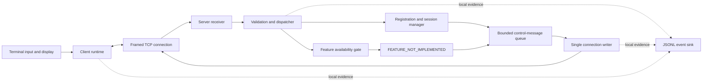

# CSE3461 Connectable Framework Implementation Plan

> **For agentic workers:** The user has selected **Native** execution. REQUIRED SUB-SKILL: Use superpowers:executing-plans to implement this plan task-by-task within the authorized skeleton-only scope below. Steps use checkbox (`- [x]`) syntax for tracking.

**Goal:** Build and verify the shared client/server framework through real TCP connection, registration, control-message exchange, and cleanup, while all business features remain unavailable.

**Architecture:** One terminal client per participant connects to a unified threaded server. The foundation owns framing, validation, registration, the online directory, bounded queues, connection lifecycle, and evidence logging. F1/F2 handlers and the shared chat publisher remain stubs; F3 A is selected for a separate later stage.

**Tech Stack:** Python 3.12+, standard library only, IPv4 TCP, `threading`, bounded `queue.Queue`, UTF-8 JSON with a four-byte length prefix, and `unittest`.

**Spec:** [Architecture and interface baseline v0.2](CSE3461_ARCHITECTURE_PROPOSAL.md), especially §§5–10 and §13. The [F1/F2 integration brief](CSE3461_F1_F2_INTEGRATION_BRIEF.md) is the companion contract for independent feature developers.

## Global Constraints

- Project identity: **CSE3461**. The workspace folder name does not rename the project.
- Scope: baseline phases **P1–P3 only**; no F1/F2 recipient-selection implementation, chat publication, active F3 behavior, or experiment runner.
- Runtime: Python **3.12 or newer**, standard library only; use one agreed minor version on the team's eventual demonstration machines.
- Wire protocol: IPv4 TCP; four-byte unsigned big-endian length; payload **1–65,536 bytes**; exact envelope keys `v`, `type`, `request_id`, `data`; `v=1`.
- Identity/content: usernames match `[A-Za-z0-9_]{1,24}`, case-sensitive; text is **1–4,096 UTF-8 bytes**, not all whitespace; control characters other than tab/newline are rejected. Accepted text is preserved.
- Client IDs: strictly increasing integers **1–9,007,199,254,740,991** per connection; boolean values are not integers. A valid new ID is consumed before later type/body rejection.
- Skeleton capabilities: `f1`, `f2`, and `f3` each advertise `{implemented:false, enabled:false, variant:null}`. Requesting an unimplemented feature at startup is an error.
- Ownership: one receiver and one writer thread per server connection; one client controller owns outgoing writes and protocol state. Features receive immutable views, never sockets or mutable session maps.
- State lock: short in-memory operations and nonblocking queue admission only; no socket I/O, logging, waiting, or feature invocation while held.
- Scope exclusions: GUI, database/history, authentication, automatic reconnect, delivery receipts/retries, global ordering, UDP, encryption, deployment, report/video production, and external submission.
- Implementation authorization: **cleared by the user on 2026-10-21 after their final confirmation with the coordinator**. Native execution of P1–P3 and S01–S14 acceptance is authorized. F1/F2, chat publication and F3 A remain outside this implementation stage.

## Review Focus

1. A registration succeeds while another connection closes or reuses its username: preserve reply-before-visibility ordering and never let old cleanup remove the new session. Covered by T4 `test_registered_reply_precedes_visibility` and `test_stale_cleanup_preserves_replacement`.
2. A peer sends part of a multibyte frame, becomes idle, then disconnects: distinguish harmless idle polling, frame expiry, and truncation without losing bytes. Covered by T2 `test_fragmented_multibyte_frame`, `test_idle_and_partial_deadlines`, and `test_eof_boundaries`.
3. The server stops while client stdin is blocked or a queue is full: terminal failure must remain observable and all network workers must exit within the shutdown budget. Covered by T4 `test_full_queue_isolates_connection`, T6 `test_terminal_failure_survives_full_event_queue`, and T7 `test_server_stop_with_blocked_stdin`.
4. A rejected body is followed by reuse of its ID or a spoofed sender: preserve validation order, reject reuse, and never invoke business code. Covered by T5 `test_rejected_body_consumes_id` and `test_spoofed_sender_never_dispatches`.
5. Logging fails after startup or user input contains terminal controls: surface failure, avoid false evidence, and do not leak message bodies into JSONL or render unsafe control sequences. Covered by T3 `test_runtime_log_failure_is_visible`, T6 `test_untrusted_display_is_escaped`, and T7 `test_logs_omit_message_bodies`.

## 1. Requirement confirmation and authorization

Version 1.1 | 2026-10-21 | **Native implementation complete; S01–S14 passed**

| Item | Recorded decision / status |
| --- | --- |
| Immediate deliverable | The user requested requirement confirmation and a separate framework plan before development. This English document is that plan. |
| Next implementation scope | Reconfirmed by the user: real connections, registration, protocol parsing, concurrency, logs, and disconnect cleanup only. F1/F2, chat delivery, and F3 A remain unimplemented. |
| External interfaces | Reconfirmed by the user: no new F1/F2 constraints; continue with architecture v0.2. |
| F3 choice | A: controlled application-layer delay/jitter, for later implementation. Selection does not enable it in this framework. |
| Plan review | Approved by the user on 2026-10-21. Execution progress and evidence are recorded separately in `framework_work/progress.md`. |
| Execution approach | Native, explicitly selected by the user: the current implementer works through the plan sequentially in this session. |
| Final implementation clearance | Cleared. The user explicitly reported final agreement with the coordinator and authorized Native development, S01–S14 acceptance, and an English handoff. No separate coordinator message is implied. |
| Observed environment | macOS; local `python3` reports 3.14.5. At planning time no Git repository or project source existed. Source/tests are now delivered. The original implementation workspace remains non-Git; a later user-authorized copy is now in the existing project repository. This does not prove Python 3.12 or other-device compatibility. |

The architecture document remains the source of contract semantics. This plan adds task order, file ownership, test cases, and completion evidence; it does not revise wire protocol v1 or the F1/F2 interfaces. If independent developers later report an incompatibility, record the actual producer/consumer difference before changing the shared contract.

The team's common Python minor version and physical-device arrangements remain coordination items. They do not prevent planning or, once authorized, local framework work. They do prevent unsupported claims about cross-device compatibility or course demonstration completion.

## 2. Framework boundary

**To implement end to end after approval:** connect → hello → register → registered → control requests/rejections → disconnect/bye → cleanup. Multiple clients must do this concurrently.

**Present only as contracts/stubs:** F1 handler, F2 handler, F3 placeholder, and `Publisher.publish`. A valid feature request receives a correlated `FEATURE_NOT_IMPLEMENTED` error. There are **zero `chat_message` events and zero `send_result` responses** from skeleton feature requests, including when a test directly supplies the publisher with a synthetic route plan.

The directory will be real foundation infrastructure. Its `find` and `others` methods will be tested as directory operations; this does not authorize implementing the F1/F2 handlers that consume them. Queue/writer tests use control frames, not a temporary chat implementation.

### Frozen feature boundary

| Contract | Foundation responsibility in this stage | Feature integration later |
| --- | --- | --- |
| `handle_broadcast(ctx: RequestContext, request: BroadcastRequest) -> FeatureOutcome` | Export shared types; defensive F1 stub returns unimplemented | F1 selects other registered sessions or returns `NO_RECIPIENTS` |
| `handle_private(ctx: RequestContext, request: PrivateRequest) -> FeatureOutcome` | Export shared types; defensive F2 stub returns unimplemented | F2 selects one captured session or returns `SELF_TARGET` / `USER_NOT_FOUND` |
| `RequestContext(sender, request_id, received_ns, directory)` | Immutable request context and read-only directory access | Handlers use these fields without creating separate registries |
| `SessionView(session_id, username, peer_address)` | Immutable registered-session snapshot with no socket | Route by captured session ID, never by a later username lookup |
| `RoutePlan(recipients: tuple[SessionView, ...])` / `FeatureOutcome` | Nonempty, unique-session recipient plan; outcome is plan or `AppError` | Shared publisher consumes the result after separately authorized implementation |
| `Publisher.publish(ctx, request, plan) -> PublishResult \| AppError` | Unimplemented for both broadcast and private requests | Foundation owner later creates chat events, assigns message IDs, and counts queue admissions |

F1/F2 developers must not send responses, access sockets, generate message IDs, add I/O threads, modify registration, or change shared schemas independently. The framework hands them stable imports and tests; it does not merge or activate their business implementations during P1–P3.

## 3. Planned files and dependencies

All paths in this section are relative to the project root. They were planned before implementation and now identify the delivered source, tests and evidence.

| Planned file(s) | Responsibility | Task |
| --- | --- | --- |
| `cse3461_chat/__init__.py`, `cse3461_chat/protocol.py` | Package marker, schemas, immutable message/request/result types, error codes and validation | T1 |
| `cse3461_chat/transport.py` | Frame encoding, buffered reads, deadlines, complete writes and idempotent socket close | T2 |
| `cse3461_chat/config.py`, `cse3461_chat/telemetry.py` | Validated immutable configuration; local JSONL sink and visible logging failures | T3 |
| `cse3461_chat/sessions.py` | Session internals, `SessionView`, read-only `Directory`, registration, queues and close coordination | T4 |
| `cse3461_chat/dispatch.py`, `cse3461_chat/server.py` | Ordered request validation, publisher stub, listener, worker startup and process supervision | T5 |
| `cse3461_chat/features/__init__.py`, `cse3461_chat/features/broadcast.py`, `cse3461_chat/features/private_chat.py`, `cse3461_chat/features/enhancement.py` | Explicit handler/descriptors table and three unavailable handlers | T5 |
| `cse3461_chat/commands.py`, `cse3461_chat/client.py` | Terminal grammar/rendering/input worker; client runtime, pending requests and entry point | T6 |
| `tests/__init__.py`, `tests/test_protocol.py`, `tests/test_transport.py` | Protocol boundaries and stream behavior | T1–T2 |
| `tests/test_config.py`, `tests/test_telemetry.py`, `tests/test_sessions.py` | Startup values, evidence failures and concurrent session lifecycle | T3–T4 |
| `tests/test_dispatch.py`, `tests/test_features.py`, `tests/test_skeleton.py` | Gates/stubs and real-socket integration | T5, T7 |
| `tests/test_commands.py`, `tests/test_client.py`, `tests/support.py` | Terminal/client behavior; minimal shared socket/process fixtures | T4–T7 |
| `README.md` | Actual setup/run commands, interface links, capabilities and scope limits | T7 |
| `outputs/CSE3461_FRAMEWORK_ACCEPTANCE.md`, `outputs/runs/<actual-run-id>/` | Acceptance record and actual captured evidence, created only during verification | T7 |

`protocol.py` holds the shared request/context/outcome types. `sessions.py` defines `SessionView` and `Directory`. Use postponed annotations and type-checking-only imports from protocol to sessions to avoid a runtime import cycle; features import the shared definitions instead of copying them. Transport and protocol never import server/client runtimes.

`ClientCommand` and `LocalUsageError` belong in `commands.py`; configuration types belong in `config.py`. `HandlerTable` in `features/__init__.py` contains the three explicitly named handlers and immutable descriptors. Package-private session lifecycle helpers may support the server/dispatcher, but are not exposed through `Directory` or to feature developers.

### Values the implementation must preserve

| Setting | Value |
| --- | --- |
| Default host / port | `127.0.0.1` / `3461`; port range 1–65,535 |
| Server CLI | `--host`, `--port`, `--max-clients`, `--features`, `--run-id`, `--log-file` |
| Client CLI | `--host`, `--port`, optional `--username`, `--run-id`, `--log-file` |
| Connections / server outgoing queue | 16 connections including unregistered; 64 frames per connection |
| Client queues / pending requests | 64 network events; 16 commands; at most 32 pending requests |
| TCP connect / client hello | 5 seconds each; hello deadline starts after TCP connection |
| Socket operation timeout | Fixed 1 second after connection; do not change it independently in reader/writer threads |
| Registration / partial frame | 30 seconds from acceptance, never extended by retry; 5 seconds from the first byte of a frame |
| Request timeout | 10 seconds; outcome unknown, no replay; registration-reply timeout closes the connection |
| Graceful drain / process shutdown | 2 seconds per graceful drain, bounded by a single 5-second overall shutdown budget |
| Exit codes | 0 for ordinary user quit; 2 for invalid arguments; 1 for unexpected runtime/connection failure |

Use named constants for non-CLI limits; do not introduce a settings framework. Tests may inject clocks or controlled faults without adding production CLI switches. Record when a test accelerates deadlines rather than implying it waited through production timing.

## 4. Execution sequence

The confirmed execution approach is **Native**: one foundation implementer works through these dependent tasks in this session, followed by a separate final review. Most changes share protocol/session invariants, so sequential ownership keeps interface changes coordinated. The user selected this approach and subsequently cleared implementation on 2026-10-21. Implementation remains in this session; one independent final review is part of the Native workflow.

Dependency order: **T1 → T2 → T3 → T4 → T5 → T6 → T7**. T3 is logically separable but does not require another workstream. Every implementation task uses a failing behavior test, minimal implementation, a passing check, and a recorded checkpoint. There is currently no Git repository: do not run commits or assume a worktree exists. If a repository is subsequently provided, follow its instructions and use task-sized commits; creating one is not part of this plan.

All commands below are **future verification instructions**, to be run from the project root after authorization. They have not been executed. Missing-module failures are acceptable on the initial red run; fixtures must then exercise the named behavior so green results are not just import checks.

### T1. Freeze executable protocol contracts

**Files:** Create `cse3461_chat/__init__.py`, `cse3461_chat/protocol.py`, `tests/__init__.py`, `tests/test_protocol.py`.

**Interfaces:** Consumes baseline §5 and §7. Produces `decode_payload(payload: bytes) -> Envelope | ProtocolError` and `validate_message(envelope: Envelope, direction: Literal["c2s", "s2c"]) -> WireMessage | AppError`, plus the shared types listed in §7. Encoding is T2's responsibility. `WireMessage` and its validated payload must remain immutable.

- [x] Write `test_strict_envelope_and_json`: duplicate JSON keys, invalid UTF-8, non-finite values, non-object JSON, extra envelope fields, and boolean IDs are rejected with the baseline error class; valid unknown types remain envelopes until typed validation.
- [x] Write `test_message_schemas_and_direction`: cover every type in baseline §5.3, exact required fields, wrong-direction errors, username boundaries 1/24/25, and text byte boundaries 1/4,096/4,097. Include multibyte text and a forbidden control character. `chat_message`/`send_result` are validated contracts, not enabled behavior.
- [x] Run `python3 -m unittest tests.test_protocol -v`; confirm the missing behavior fails.
- [x] Implement the types and two functions with ordered envelope versus payload checks. Preserve unknown type/version for the dispatcher's subsequent ordered validation; do not consume request IDs here.
- [x] Run `python3 -m unittest tests.test_protocol -v`; require all cases to pass and record the checkpoint.

**Exit evidence:** Validated shared data types and schema behavior, with no sockets, feature routing, or application startup yet.

### T2. Implement bounded framed TCP transport

**Files:** Create `cse3461_chat/transport.py`, `tests/test_transport.py`.

**Interfaces:** Consumes T1 decoding/types. Produces `encode_frame(message: WireMessage) -> bytes`, `FramedConnection.receive(deadline_ns: int | None) -> Envelope | None`, `write(message: WireMessage) -> None`, and `close() -> None`. Receive raises transport/protocol failures or `ReadDeadline`. Add foundation-only read metadata for the most recently completed frame: payload byte count and monotonic receive-complete timestamp, captured before decoding/log I/O; it is not a wire field.

- [x] Write `test_fragmented_multibyte_frame` and `test_coalesced_frames`: split all header boundaries and a UTF-8 code point; concatenate multiple frames; assert exactly the intended ordered envelopes and no lost/duplicated bytes.
- [x] Write `test_idle_and_partial_deadlines` and `test_eof_boundaries`: idle socket polling is harmless; partial frames expire after 5 seconds from their first byte; caller deadlines also fire while idle; clean between-frame EOF returns `None`, while partial header/body EOF raises `TRUNCATED_FRAME`.
- [x] Write `test_length_and_failed_write`: lengths 0 and 65,537 are rejected before body allocation; an in-range frame can be decoded; write failure/timeout is surfaced once with no retry; close is idempotent and unblocks reads.
- [x] Run `python3 -m unittest tests.test_transport -v`; confirm the missing behavior fails.
- [x] Implement complete-frame encoding, bounded buffered reads that survive timeout polls, one write attempt per frame, and socket shutdown. Preserve the fixed socket timeout and use the earlier applicable receive deadline.
- [x] Run `python3 -m unittest tests.test_protocol tests.test_transport -v`; require all cases to pass and record the checkpoint.

**Exit evidence:** Actual local socket tests prove framing and failure semantics. They do not prove application registration or chat.

### T3. Establish configuration and evidence recording

**Files:** Create `cse3461_chat/config.py`, `cse3461_chat/telemetry.py`, `tests/test_config.py`, `tests/test_telemetry.py`.

**Interfaces:** Consumes T1 constants/schema rules. Produces immutable `ServerConfig`/`ClientConfig`; `parse_server_args(argv: Sequence[str] | None) -> ServerConfig`; `parse_client_args(argv: Sequence[str] | None) -> ClientConfig`; `open_event_sink(role: Literal["server", "client"], run_id: str | None, log_file: str | None) -> EventSink`; `EventSink.emit(name: str, fields: object) -> None`; `EventSink.close() -> None`; and a visible `TelemetryError` failure. An omitted log path creates no log file; an omitted run ID is generated per actual process run and is not assumed shared across clients.

- [x] Write `test_config_defaults_and_rejections`: assert the values in §3, validate addresses/ports/usernames, reject nonpositive capacity and any requested unimplemented feature, and preserve argument-error exit 2.
- [x] Write `test_jsonl_sequence_and_metadata`: concurrent emits produce complete parseable records with unique increasing local `seq`, schema version 1, process-instance UUID, run ID, role, UTC time, monotonic time, event, and fields. Preserve event-specific occurrence timestamps rather than substituting later log-write time.
- [x] Write `test_log_open_failure_precedes_network` and `test_runtime_log_failure_is_visible`: opening a requested inaccessible destination fails; a controlled later write failure raises `TelemetryError`. Verify no message-body field is added by the sink. Runtime shutdown effects are exercised in T7.
- [x] Run `python3 -m unittest tests.test_config tests.test_telemetry -v`; confirm the missing behavior fails.
- [x] Implement configuration validation and the small serialized JSONL sink. Open requested logs before network startup; let runtimes contain failures and report invalid evidence. Keep log I/O outside session locks.
- [x] Run `python3 -m unittest tests.test_config tests.test_telemetry -v`; require all cases to pass and record the checkpoint.

**Exit evidence:** Validated startup configuration and inspectable evidence records. No experiment metrics, result CSVs, or prefilled success records exist.

### T4. Implement session registration, queues, and cleanup

**Files:** Create `cse3461_chat/sessions.py`, `tests/test_sessions.py`; add only needed shared fixtures to `tests/support.py`.

**Interfaces:** Consumes T1 types, T2 channels, T3 limits/event sink. Produces immutable `SessionView`, read-only `Directory.find(username: str) -> SessionView | None`, `Directory.others(origin_session_id: str) -> tuple[SessionView, ...]`, and these `SessionManager` methods: `register(session_id, username, registered_reply) -> SessionView | AppError`; `enqueue(session_id, message, meta: DeliveryMeta | None) -> EnqueueResult`; `close(session_id, reason, final_message: WireMessage | None, drain: bool) -> None`. Runtime-only helpers own attachment, state/ID access, and worker/queue coordination; callers never mutate maps directly.

- [x] Write `test_atomic_registration_and_deadline`: simultaneous claims for one username have exactly one winner; an invalid/duplicate name can retry only within the original 30 seconds; unregistered connections consume capacity; failed registration-reply admission creates no active name.
- [x] Write `test_registered_reply_precedes_visibility` and `test_directory_snapshots`: `registered` is queued before lookup exposes the session; directory snapshots include only registered, non-closing sessions and expose no socket.
- [x] Write `test_stale_cleanup_preserves_replacement`: disconnect and reuse a username, then repeat old-session cleanup; the new session survives. Enqueue to the old ID returns closed and never targets the replacement.
- [x] Write `test_full_queue_isolates_connection` and `test_concurrent_control_frames`: fill the 64-frame queue without a writer; the next admission reports `full`; closing that session preserves another healthy session. Concurrent producers through one writer yield complete control frames without interleaving bytes or losing admitted records.
- [x] Run `python3 -m unittest tests.test_sessions -v`; confirm the missing behavior fails.
- [x] Implement manager-owned connection state, one short registry lock, bounded FIFO admission, and idempotent closing. Use an already-locked enqueue helper for registration; record events and perform socket operations only after releasing the registry lock. Remove the active username before draining, avoid self-join, and retain connection capacity until cleanup completes.
- [x] Run `python3 -m unittest tests.test_sessions -v`; require all cases to pass and record the checkpoint. Use barriers/events for race tests rather than relying on arbitrary sleeps.

**Exit evidence:** Real registration and lifecycle infrastructure with tested invariants. No feature handler selects recipients or publishes chat.

### T5. Wire the server and unavailable feature paths

**Files:** Create `cse3461_chat/dispatch.py`, `cse3461_chat/server.py`, `cse3461_chat/features/__init__.py`, `cse3461_chat/features/broadcast.py`, `cse3461_chat/features/private_chat.py`, `cse3461_chat/features/enhancement.py`, `tests/test_dispatch.py`, `tests/test_features.py`, and initial `tests/test_skeleton.py`.

**Interfaces:** Consumes T1–T4. Produces `Dispatcher.handle(session_id: str, envelope: Envelope, received_ns: int) -> None`; the frozen publisher/handler interfaces in §2; `handle_enhancement(ctx: RequestContext, request: EmptyEnhancementRequest) -> AppError`; `build_handlers() -> HandlerTable`; `ServerRuntime.run(config: ServerConfig, handlers: HandlerTable, events: EventSink) -> int`; and `ServerRuntime.stop(reason: str) -> None`.

- [x] Write table-driven `test_dispatch_validation_order`: version/ID → direction/type → body → state → implementation/enabled gate. Include unknown type, wrong direction, pre-registration feature request, duplicate registration, and best-effort fatal errors with correct correlation.
- [x] Write `test_rejected_body_consumes_id` and `test_spoofed_sender_never_dispatches`: a body rejection consumes the valid ID; reuse then causes fatal `BAD_REQUEST_ID` with null correlation. Extra `sender` is rejected, and a handler spy records zero invocations.
- [x] Write `test_feature_stubs_and_publisher_are_unavailable`: direct calls and valid wire requests return `FEATURE_NOT_IMPLEMENTED` with the correct `f1/f2/f3`. A fixture route plan still cannot make the publisher emit chat or return a send result. Verify the separate disabled gate with a descriptor-only test fixture, without activating any runtime feature.
- [x] Write `test_three_clients_with_one_unregistered`, `test_capacity_rejection_before_workers`, and `test_listener_failures`: one idle registration does not block two others; the seventeenth connection is closed before session workers start at the default capacity; bind failure produces no false listening state.
- [x] Run `python3 -m unittest tests.test_dispatch tests.test_features tests.test_skeleton -v`; confirm the missing behavior fails.
- [x] Implement dispatcher, unavailable stubs, explicit handler wiring, and the server entry point. Queue hello first; enforce the acceptance-time registration deadline and monotonic request IDs; start one receiver/writer pair per admitted connection; contain client failures without stopping healthy sessions.
- [x] Implement bounded server supervision: stop accepting, initiate all session closes, then join against one overall 5-second deadline. Do not spend a fresh 2-second drain or 5-second join budget sequentially on every session. Signal handling requests stop without blocking on network operations.
- [x] Run `python3 -m unittest tests.test_dispatch tests.test_features tests.test_skeleton -v`; require all cases to pass and record the checkpoint.

**Exit evidence:** A real server accepts and registers raw framed clients, handles control traffic, and rejects every feature honestly. No terminal-client completion claim yet.

### T6. Implement the terminal client and responsive lifecycle

**Files:** Create `cse3461_chat/commands.py`, `cse3461_chat/client.py`, `tests/test_commands.py`, `tests/test_client.py`; extend `tests/support.py` only for deterministic peer/input fixtures.

**Interfaces:** Consumes T1–T3 and the T5 server contract. Produces `parse_input(line: str) -> ClientCommand | LocalUsageError`; `ClientRuntime.connect(config: ClientConfig, events: EventSink) -> ConnectionInfo`; `send(type: str, data: object) -> int`; `next_event(timeout_s: float) -> ClientEvent | None`; and `close(reason: str) -> None`. The controller alone calls these runtime methods and owns state/pending changes; the receiver posts validated events and transport termination.

- [x] Write `test_command_grammar`: plain text and `/all <text>` select broadcast; `@bob <text>` selects private; remove the first separating whitespace and preserve the remaining body. `/all @literal` broadcasts literal text. Malformed `@`, missing bodies and unknown slash commands send nothing; `/help` is local; `/enhance` is the empty stub request.
- [x] Write `test_client_handshake_and_request_state`: show actual local/server endpoints; do not treat TCP connection as registration; allocate increasing request IDs; retry a rejected username; enforce the 5-second hello deadline and 32-pending cap; preserve registered state after feature rejection.
- [x] Write `test_timeout_and_late_response`: a 10-second request expiry becomes unknown with no resend; registration-reply expiry closes; other late replies show their ID without reopening completed pending state. Invalid server messages close locally without sending a server-style error back.
- [x] Write `test_terminal_failure_survives_full_event_queue` and `test_untrusted_display_is_escaped`: a full 64-event queue cannot hide EOF/overflow; pending outcomes become unknown. Render unsafe control sequences as safe visible text, including untrusted error details.
- [x] Run `python3 -m unittest tests.test_commands tests.test_client -v`; confirm the missing behavior fails.
- [x] Implement command parsing/rendering and the controller state machine. Use a daemon stdin reader with a bounded 16-command queue and no socket/log ownership; block input admission instead of silently dropping commands. Use a non-daemon receiver plus a separate terminal-reason latch so queue overflow is observable. Main/controller is the sole socket writer and terminal output owner.
- [x] Implement quit/EOF/close with bounded network-worker cleanup, correct exit codes and visible pending outcomes. Local submission is never labeled delivery. Do not implement automatic reconnect or resend.
- [x] Run `python3 -m unittest tests.test_commands tests.test_client -v`; require all cases to pass and record the checkpoint.

**Exit evidence:** The actual terminal client participates in the framework lifecycle while still reporting all three features unavailable.

### T7. Verify the complete framework and prepare the handoff

**Files:** Extend `tests/test_skeleton.py` and existing focused tests only for remaining acceptance gaps; create `README.md`, then the actual acceptance record and run evidence listed in §3.

**Interfaces:** Consumes the completed client/server entry points and every earlier task's interfaces. Produces an acceptance record mapped to S01–S14, reproducible startup instructions, and an explicit list of remaining feature work.

- [x] Add `test_requested_log_open_failure_starts_no_network`: exercise both entry points with an unusable requested log destination; assert nonzero exit and no listener/connect call. This verifies startup ordering beyond the sink's unit test.
- [x] Add `test_server_stop_with_blocked_stdin`, `test_multi_session_shutdown_budget`, and `test_runtime_logging_failure_stops_process`: use actual subprocesses/pipes or controlled socket peers; prove shutdown without an extra keystroke, a shared 5-second shutdown target, and nonzero exit plus invalid-evidence diagnostics after a requested log fails.
- [x] Add `test_logs_omit_message_bodies` and `test_cli_and_raw_features_remain_unavailable`: use distinctive body text, check logs contain no body, exercise all three feature paths, and assert no recipient chat events or sender send results. Use bounded observation plus synchronized request completion, not an unbounded wait for a forbidden event.
- [x] Run `python3 -m unittest tests.test_skeleton -v`; identify any missing behavior and repair only the owning framework modules. Do not relax the accepted boundary to make tests pass.
- [x] Write README commands that match the implemented argument parser, shared-type import locations, feature ownership, timeout/outcome language, and links to the baseline/brief. Explain LAN addressing without claiming a physical-device test.
- [x] Run `python3 -m unittest discover -s tests -t . -v`; require zero failures/errors. Run both `python3 -m cse3461_chat.server --help` and `python3 -m cse3461_chat.client --help` and check the documented arguments.
- [x] Perform the manual localhost scenario in §5 with one server and three actual clients. Record observed results and failures, interpreter/OS, configuration and actual log paths; create evidence files only from these runs.
- [x] Review ownership and scope against S13: actual threads, one socket writer, no I/O/logging/waits under registry lock, immutable feature descriptors, no active handlers/publisher, no F3 hook, and no unbounded shutdown loop. Record any unresolved finding rather than declaring acceptance.
- [x] Complete `outputs/CSE3461_FRAMEWORK_ACCEPTANCE.md`: each S01–S14 row states pass/fail/not run, evidence location, environment, and limitations. Stop after the framework handoff; do not begin P4/P5 automatically.

**Exit evidence:** All S01–S14 are supported by actual checks with no unresolved acceptance failure. If any mandatory row is failed or unrun, report partial completion with that exact gap.

## 5. Acceptance and measurement

Framework measurements concern correctness, bounded resources, and shutdown. They are not F1/F2 delivery results or F3 performance measurements. Use process-local monotonic time for deadlines/durations; do not subtract unsynchronized clocks from different machines.

| Baseline ID | Required evidence | Owner / check |
| --- | --- | --- |
| S01 | Help works; invalid config, occupied port and invalid feature enablement produce honest errors/exits | T3 config tests; T5 listener tests; T7 entry-point checks |
| S02 | Three localhost clients connect; leaving one unregistered does not block the others; actual endpoints displayed | T5 integration; T6 endpoint/state tests; manual run |
| S03 | Exactly one duplicate-name winner; original registration deadline survives retries; capacity released | T4 session tests; T5 registration integration |
| S04 | Split/coalesced frames and multibyte splits yield exactly the intended ordered messages | T2 socket tests |
| S05 | Malformed length/UTF-8/JSON, truncation and expiry cause bounded failure; a healthy client still works | T1/T2 negative tests plus T7 healthy-client follow-up |
| S06 | Version/direction/type/ID/state/body rejection follows contract; no spoofed identity or handler invocation | T1 schemas; T5 dispatcher tests |
| S07 | CLI and raw F1/F2/F3 requests are correctly correlated unimplemented errors; no chat or send-result output | T5 direct/wire tests; T7 CLI integration |
| S08 | Invalid private syntax never broadcasts; `/all @literal`, help and other commands behave as documented | T6 command tests; manual run |
| S09 | Quit, stdin EOF, reset and server stop clean up without keyboard input; pending outcomes are unknown where appropriate | T6 lifecycle tests; T7 blocked-stdin/multi-session shutdown tests |
| S10 | Same-name reconnection is independent of old cleanup; old session IDs never redirect | T4 stale-cleanup tests |
| S11 | Bounded queue failure; intact concurrent control frames; another connection remains healthy; publisher remains a stub | T4 queue tests; T5 publisher test |
| S12 | Parseable correlated lifecycle records; log failure visible; invalid evidence cannot be presented as complete | T3 sink tests; T7 runtime fault/log inspection |
| S13 | Thread/write/lock ownership and inactive capabilities confirmed by code review and runtime checks | T4/T5/T6 tests; T7 inspection |
| S14 | README commands and evidence labels match reality; localhost is not called a real-device demo | T7 documentation/evidence review |

Where S05/S09 require end-to-end variants not already covered, T7 extends `test_skeleton.py` with a parameterized malformed-peer/reset case and confirms another client can still register. Use ephemeral ports in automated tests; reserve port 3461 for the documented manual example. Tests should clean up their sockets and processes even on assertion failure.

### Manual localhost scenario after authorization

1. Start one server with `--features none` and a real per-process log path. Start Alice, Bob, and a third client without a supplied username.
2. Leave the third client at the username prompt. Confirm Alice/Bob register and show real endpoints. Attempt a duplicate name, then a distinct name within the original registration deadline.
3. From a registered client submit plain text, `@bob Hello`, and `/enhance`. Each receives its correct unavailable error; peers receive no chat event and the sender receives no send result.
4. Try malformed `@` input, an unknown slash command, `/all @literal`, and `/help`. Check local errors versus actual requests and current capability display.
5. Quit one client, reconnect using its name, then stop the server while another client waits for keyboard input. Record cleanup and shutdown duration; no extra keystroke should be needed for network termination to be observed.
6. Inspect JSONL for actual startup/configuration, connection, registration, request rejection, queue/write, and shutdown events. Verify message bodies are absent, errors are visible, and no future-only route/chat events are fabricated.

Execution results are recorded in the linked acceptance report and ledger. Logs use the schema and event fields in baseline §10. An acceptance report must distinguish normal runs from fault-injection runs and automated fixtures from the manual scenario. A missing final log record after sink failure is explained by stderr/nonzero exit, not replaced with invented evidence.

## 6. Handoff and next authorization boundary

The framework handoff consists of source/tests, README, an S01–S14 acceptance record, and actual evidence. Independent F1/F2 developers receive the stable function/import contracts, directory semantics, request schemas, error behavior, and an explicit notice that the shared publisher is still unavailable.

After acceptance, a separately authorized F1/F2 stage implements the shared publisher and the independent handlers together, then verifies real chat behavior. F3 A remains a subsequent stage: finalize its writer hook, delay/jitter parameters, workload, and baseline/treatment measurement method on a working chat path. No reserved UDP service, active delay mechanism, experiment runner, or synthetic result is included here.

**Current decision:** the user approved this plan, selected Native execution, and subsequently confirmed final agreement with the coordinator on 2026-10-21. Development, S01–S14 acceptance and an English handoff are authorized. Scope remains the connectable skeleton only: F1/F2, chat publication, and F3 A remain unimplemented. Current execution evidence is in [the ledger](framework_work/progress.md); final status is reported in [acceptance](CSE3461_FRAMEWORK_ACCEPTANCE.md) and [the handoff](CSE3461_FRAMEWORK_HANDOFF.md).

### Planning verification record

This records the original planning stage; current execution status is linked above.

- Checked the plan against architecture v0.2 and the English F1/F2 brief; no external interface or capability change is proposed.
- Mapped every S01–S14 criterion to an owning task and verification method; mapped the five review-focus failure classes to named tests.
- Kept implementation signatures consistent with the baseline and placed new foundation-only configuration/wiring helpers with their owners.
- At the original planning checkpoint, all implementation/evidence steps were unchecked; application/test files and results were future work. The checkboxes above now record completed execution.
- Current environment inspection found Python 3.14.5 and no Git repository. No software compatibility, application behavior, or test pass is claimed by this document.

### Revision history

| Version | Date | Change |
| --- | --- | --- |
| 1.0 | 2026-10-21 | Independent framework plan with seven tasks and S01–S14 acceptance coverage; documentation only. |
| 1.1 | 2026-10-21 | Recorded user approval and Native selection; retained the explicit wait for final user-and-coordinator confirmation and unchanged skeleton-only scope. |

Execution authorization recorded on 2026-10-21 without changing plan v1.1 interface or feature scope.

Execution completed on 2026-10-21: seven tasks complete, S01–S14 passed, 49 automated tests passed, supervised three-client localhost evidence retained, and both Important final-review findings fixed with observed regression failures followed by passes. See the acceptance record for current evidence and limits. No later feature stage has started.
